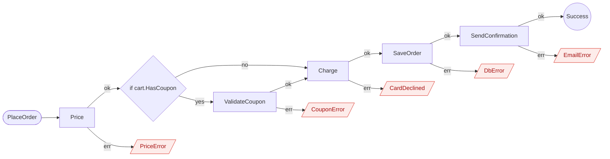

# errpath

**See every way your Go functions can fail. Catch the pull requests that change it.**

errpath lets you:

- draw every error path of a function as a diagram, straight from your code
- review pull requests for new panics, dropped errors and changed error paths
- make sure every error you handle reaches your OpenTelemetry traces
- mark the deliberate ones with a reason, so the review stays quiet about them

It reads source, so there's nothing to build or configure.

[Step through a function's error paths yourself](https://jagreehal.github.io/errpath-go/), before and after a pull request.

```bash
go install github.com/jagreehal/errpath-go/cmd/errpath@latest
```

---

## The problem

Go makes errors values, which is great. But some changes to error handling look harmless in a diff:

```go
_ = SendConfirmation(receipt)           // the error is thrown away
re := regexp.MustCompile(userPattern)   // panics on bad input
if err != nil { log.Println(err) }      // handled, but never reaches a trace
```

Each one compiles, passes the tests, and is easy to approve. And in a long function with a dozen `if err != nil` checks, it's hard to say which errors can reach the caller at all.

errpath reads the code and shows you.

---

## See every way it can fail

Here's a checkout ([examples/checkout](examples/checkout/checkout.go)):

```go
func PlaceOrder(cart Cart, card Card) (Receipt, error) {
	total, err := Price(cart)
	if err != nil {
		return Receipt{}, err
	}
	if cart.HasCoupon {
		if err := ValidateCoupon(cart); err != nil {
			return Receipt{}, err
		}
	}
	payment, err := Charge(card, total)
	if err != nil {
		return Receipt{}, err
	}
	receipt, err := SaveOrder(cart, payment)
	if err != nil {
		return Receipt{}, err
	}
	if err := SendConfirmation(receipt); err != nil {
		return Receipt{}, err
	}
	return receipt, nil
}
```

```bash
errpath diagram ./examples/checkout PlaceOrder
```

prints this diagram, which GitHub draws for you in any README, issue or PR:



Each call whose error is checked and returned is a step. Every red box is a way `PlaceOrder` can fail, and the coupon check only happens on one branch.

### Step through it

`errpath machine` prints the same paths as an [XState](https://stately.ai/docs/xstate) state machine, so you can click through them:

```bash
errpath machine ./examples/checkout PlaceOrder -o PlaceOrder.json
```

Open `PlaceOrder.json` in [autovisualizer](https://auto-visualizer.vercel.app) and send `ok` or `err` from each step to walk a path. To put it on your own page, embed it with no build step:

```html
<script type="module" src="https://cdn.jsdelivr.net/npm/autovisualizer/public/embed/embed.js"></script>
<auto-visualizer src="PlaceOrder.json"></auto-visualizer>
```

Put the machine from before a change in `base`, as the JSON or the `#id` of a `<script type="application/json">` holding it, and the chart marks what the change added and removed. [This page](https://jagreehal.github.io/errpath-go/) shows `PlaceOrder` both ways, as a flowchart you click through and as a state machine, before and after a pull request.

### Naming the errors

A Go signature only says `error`, so errpath works out which error from the code:

- a function whose failing returns all name their error is labelled with them: `return 0, &PriceError{}` and `return 0, ErrNotFound` make `PriceError | ErrNotFound`
- otherwise, name it in the doc comment:

  ```go
  // errpath: error PriceError
  func Price(cart Cart) (int, error) { ... }
  ```

- `fmt.Errorf("charge: %w", err)` wraps the error, so it keeps its name. Returning a different error, such as `return ErrPaymentFailed`, shows that one instead.

Anything it can't name shows as `error`.

---

## Catch risky changes in pull requests

Say a PR changes one line:

```diff
-	if err := SendConfirmation(receipt); err != nil {
-		return Receipt{}, err
-	}
+	_ = SendConfirmation(receipt)
```

The tests still pass. But a failed confirmation email now disappears without a trace. `errpath review` compares the error paths before and after, and posts:

> ## Error path review: moderate risk
>
> 1 function changed, 1 new finding.
>
> ### New findings
>
> - `no-swallow` `_ = drops the error from SendConfirmation` at `checkout/checkout.go:89`
>
> ### Changed error paths
>
> #### `checkout.PlaceOrder`
>
> - added dropped error from `SendConfirmation`
> - removed step `SendConfirmation` → `EmailError`
>
> ▶ Error path diagram

What it flags:

| Finding | Example | Why it matters |
| --- | --- | --- |
| New panic (`no-panic`) | `panic(...)`, `log.Fatal`, `os.Exit`, a `Must*` call | crashes instead of returning an error |
| Dropped error (`no-swallow`) | `_ = Save()`, `v, _ := Load()`, or `Save()` on its own line | the failure vanishes |
| Untraced error (`no-trace`) | `if err != nil { retry() }` with nothing recording `err` | it's handled, but your traces never show it |
| Changed error path | a step added, removed, moved into a branch, or now returning a different error | callers can now see different errors |
| Bad allow comment (`bad-allow`) | an allow comment with no reason | it silences nothing |

Risk is `low`, `moderate` or `high`:

| Risk | When |
| --- | --- |
| high | a new panic or exit that will certainly happen if reached |
| moderate | a new dropped error, a handler that records nothing, a possible panic (`Must*`), a bad allow comment, a file that no longer parses, or a change to what happens after an error |
| low | anything else, such as a new step that returns its error as is |

Reviews start from where your branch left the base branch, so changes merged there since aren't reported as yours. Moving or renaming a function, renaming a variable or reformatting doesn't count as a change.

### GitHub Action

```yaml
name: errpath
on: pull_request

permissions:
  contents: read
  pull-requests: write # to post the review comment

jobs:
  review:
    runs-on: ubuntu-latest
    steps:
      - uses: actions/checkout@v7
      - uses: jagreehal/errpath-go@v0.1.1
        with:
          fail-on: high # never, moderate or high
```

It keeps one comment up to date per PR, annotates new findings inline, and writes the report to the job summary. Other inputs: `path` to review only some directories, `comment-on` for the lowest risk worth a comment (default `moderate`), and `diagrams: open` to expand diagrams in the comment.

Run it locally with `errpath review --base main`.

### When it's deliberate

Say why, and the finding is listed as allowed instead:

```go
// errpath: allow(no-swallow) metrics are best effort
_ = SendMetrics()

func init() {
	// errpath: allow(no-panic) the pattern is a constant
	slug = regexp.MustCompile(`^[a-z0-9-]+$`)
}
```

An allow comment covers the statement on the next line, or the statement it sits on. It needs a reason: without one it's ignored and flagged as `bad-allow`.

---

## Errors you can see in your traces

errpath is OpenTelemetry first. An error you handle, rather than return, leaves no trace unless the handler records it. The service carries on, and nobody learns the email never went. The `no-trace` rule is always on: there's nothing to turn on or configure, and it flags a handler that records nothing:

```go
// flagged: the error stops here, and nothing records it
if err := SendConfirmation(receipt); err != nil {
	retryLater(receipt)
}

// passes: the error reaches your traces
if err := SendConfirmation(receipt); err != nil {
	slog.WarnContext(ctx, "confirmation email failed", "error", err)
	retryLater(receipt)
}
```

Every path through the handler has to record, so `if fatal { return }` followed by a log call is still flagged: the path that returns early drops the error. The same goes for a `return` inside a loop. `break`, `continue` and `fallthrough` are followed to where they land. A path is fine when it:

- records on an OpenTelemetry or autotel span: `span.RecordError(err)`, `span.SetStatus(codes.Error, ...)`, `span.AddEvent(...)`. A span from a parameter, a field, `trace.SpanFromContext(ctx)`, `autotel.Start` or a tracer's `Start` is recognised, including a package-level `var tracer = otel.Tracer("app")`, and a status through a constant (`const failure = codes.Error`)
- logs with `log/slog`, at any level, through the package or a `*slog.Logger` (a parameter, field, `slog.Default()`, `slog.New(...)`, `autotel.Logger(...)`)
- calls anything in [autotel](https://github.com/jagreehal/autotel-go), such as `autotel.RecordError(ctx, err, nil)`
- calls a function in your module that, on every path, does one of those or stops the program, such as `s.fail(w, err)`. A helper that logs only `if enabled` doesn't count. One that starts with `if err == nil { return }` does when it's given the handled error, which is set. That holds until the helper assigns `err`
- hands the error on: returns it, stores it (`err = fmt.Errorf("...: %w", err)`, `errs = append(errs, err)`) or sends it on a channel. The value has to hold the error itself: the error, a composite literal holding it, `append`, `errors.Join`, `fmt.Errorf` with `%w` on that argument (`fmt.Errorf("%w: %v", ErrX, err)` wraps `ErrX`, not `err`), or a function in your module that hands it back (see below). `_ = err`, `failed = err != nil`, `errors.Is(err, ...)`, `err.Error()`, `fmt.Sprint(err)` and `fmt.Errorf` with `%v` keep only a copy of its text, or nothing
- stops the program, with `panic`, `log.Fatal` or `os.Exit` (which `no-panic` reports)

A function in your module hands the error back when every path returns something holding its argument, records, or stops. errpath follows the function's locals in order, so `saved := err; return saved` counts, and every argument of a variadic `...error` counts. It gives up, and you get the finding, when the function:

- returns `nil`, or sets the error to `nil` before returning it
- keeps the error only in an inner variable that shadows the one it returns
- has a `defer` that overwrites its named error result
- writes something else into a field or element that held the error (`out.Err = nil`, `errs[1] = nil`), directly, through a type assertion, or through a variable sharing that storage (`alias := errs`). A literal written to a `string`, number or `bool` field is fine.
- passes what holds the error to something that may write into it: `clear`, `copy`, `append`, `slices.Delete` and similar, a module function that writes into that parameter or receiver, or any function errpath can't see into
- writes the variable inside a closure, or takes its address (`reset(&err)`), since errpath can't follow a write through a pointer

`log.Printf`, `fmt.Println` and `println` don't count, because nothing carries them to a trace. Neither does logging in a function literal or a `go` statement, because nothing says it runs. `SetStatus` on something that isn't a span, like an HTTP response, doesn't count either. A logging or span method on a value whose type errpath can't see, like `logger.Error(...)` with `logger` from another module, gives a `possible` finding.

The review flags a new handler that records nothing, and an existing handler that stops recording.

This is a static check. It shows that each error reaches a span or `slog`. Whether that reaches your backend depends on the service exporting it. With [autotel](https://github.com/jagreehal/autotel-go) that's two lines at the top of `main`, and every `slog` call in the program reaches your traces:

```go
cleanup, err := autotel.Init(ctx, autotel.WithService("orders"))
if err != nil {
	log.Fatal(err)
}
defer cleanup()
slog.SetDefault(autotel.Logger("orders"))
```

Use the `...Context` methods (`slog.ErrorContext(ctx, ...)`), so each log line carries the trace it belongs to.

---

## What the analyzer follows

errpath reads your code without building or running it. It follows:

- `if err != nil` after a call, including a check a few lines further down, and `if err := f(); err != nil`
- `return f()`, `return v, err`, and a bare `return` with a named error result
- what happens on the error path before it returns: logging, cleanup, wrapping
- errors handled instead of returned, including `errors.Is` and `errors.As` checks
- `if` / `else`, `switch`, type switches, `select`, `for` and `range`, with `break`, `continue`, `fallthrough`, labels and `goto`
- `panic`, `os.Exit`, `log.Fatal*`, `log.Panic*`, and `Must*` helpers, including in loop conditions and `defer`
- `defer` with `recover()`
- function literals, each as its own function (`F.each`, `F.go1`, `F.defer1`)

It reads function bodies, so a `Must*` in a package-level `var` isn't checked. It finds which function a call reaches through imports in the same module, package-level functions, and methods on types it can see declared: receivers, parameters, locals, struct fields and interfaces.

It doesn't follow:

- methods on types from other modules (`f.Close()` on an `*os.File`), so it won't flag their dropped errors. [errcheck](https://github.com/kisielk/errcheck) covers those.
- a method called on a value whose type it can't see. It matches those by method name, and only flags them as `possible` when every method of that name returns an error.
- calls through function values (`step := check; step(x)`)

---

## Quick reference

### CLI

| Command | Prints |
| --- | --- |
| `errpath diagram <path> <function>` | Mermaid diagram |
| `errpath machine <path> <function>` | XState state machine (JSON) |
| `errpath review --base <ref> [paths...]` | PR review (Markdown, or JSON with `--format json`) |
| `errpath ir [path]` | everything errpath found, as JSON |

`<function>` is a name (`PlaceOrder`), a method (`Service.Put`) or a full id (`checkout.PlaceOrder`). Add `-o <file>` to write to a file. `review` also takes `--head <ref>` (default `HEAD`), `--repo <dir>` and `--diagrams open|collapsed`.

### Comments

| Comment | Does |
| --- | --- |
| `// errpath: error PriceError` | on a function's doc comment: names the error it returns |
| `// errpath: allow(no-swallow) <reason>` | allows a dropped error on the next statement |
| `// errpath: allow(no-panic) <reason>` | allows a panic on the next statement |
| `// errpath: allow(no-trace) <reason>` | allows a handler that doesn't record its error, on the next `if` |

---

## Common pitfalls

- **`_ = f()`, `v, _ := f()` and a bare `f()` all drop the error.** If that's deliberate, say why in an allow comment.
- **`log.Printf` in a handler isn't recording.** It goes to stderr, not to your traces. Use `slog.ErrorContext(ctx, ...)` or `span.RecordError(err)`.
- **`Must*` panics.** That's fine for constants at startup and risky on request input. errpath flags it as a possible panic either way, so allow the startup ones.
- **Check the error before anything else can leave.** `v, err := f()` followed by a `return` or `continue` before `if err != nil` drops the error on that path. A `defer` in between runs even when the call failed.
- **`fmt.Errorf` without `%w` loses the original error.** Callers can no longer match it with `errors.Is` or `errors.As`, and errpath shows it as `error`.
- **Name errors that come from many places.** If a function returns errors from several sources, errpath shows `error` unless you add `// errpath: error ...`.

---

## When to use errpath

**Use it when:**

- you review changes to code where failures matter, such as payments, data or anything that talks to the network
- you want to see how errors flow through a function before changing it

**Skip it when:**

- you want every unchecked error in the codebase listed. That's [errcheck](https://github.com/kisielk/errcheck) (also in [golangci-lint](https://golangci-lint.run)). errpath is about changes: what a PR does to your error paths, with diagrams to show it.

errpath also exists for [Rust](https://github.com/jagreehal/errpath) and [Python](https://github.com/jagreehal/errpath-python).

Using a coding assistant? `npx skills add jagreehal/errpath-go --skill errpath` teaches it to run errpath and fix what it finds. See [skills](skills/README.md).

---

## Development

```bash
make test      # tests, with the race detector
make quality   # format, lint, test
make ci        # quality, then build
```

The analyser is pinned by a corpus in [testdata/corpus](testdata/corpus). After an intended change to its output, run `go test -run TestCorpusGolden -update .` and review the diff. A mutation test edits the corpus hundreds of ways and checks the review reports exactly the edits that touch an error path. See [CONTRIBUTING.md](CONTRIBUTING.md).

## License

MIT
